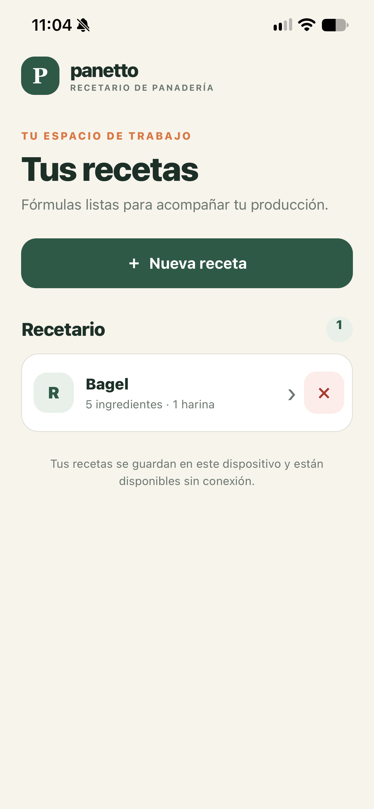
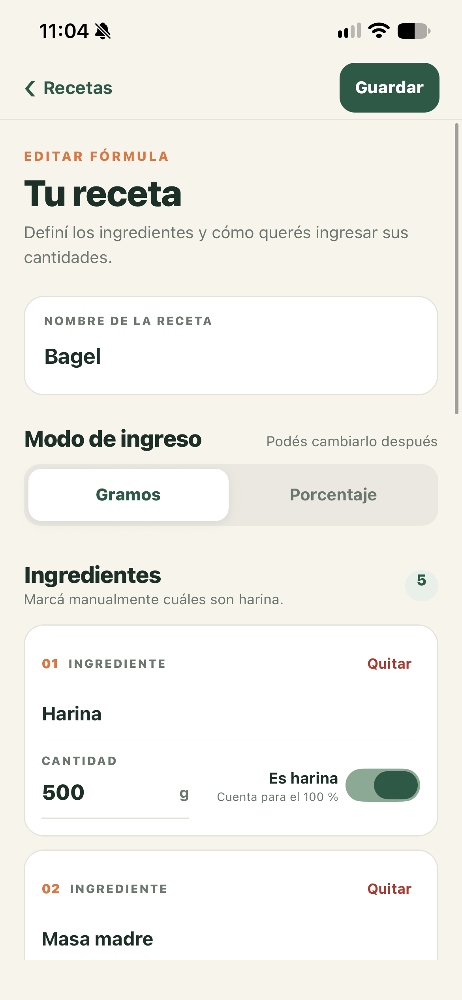
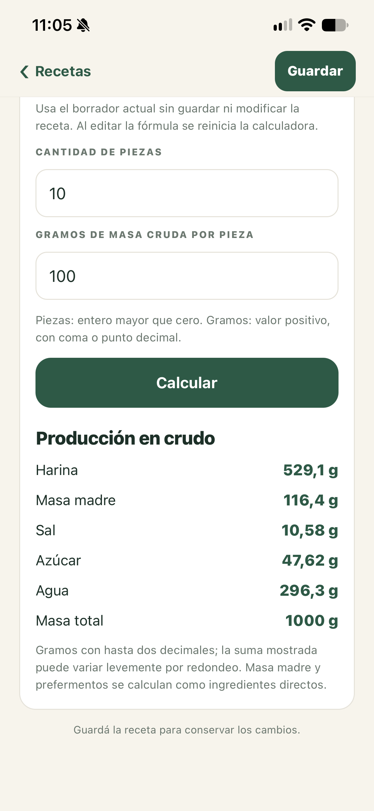

# Panetto

Recipe and production calculator for bakers, based on baker's percentages. Enter the weights of a reference recipe, choose how many pieces you want and the raw dough weight of each, and Panetto calculates the quantities to prepare.

- **Mobile (Expo / React Native / TypeScript):** in `mobile/`. Recipe books are stored locally on the device with SQLite; nothing is synced online, and recipes work offline.
- **macOS (SwiftUI):** build with `./scripts/build.sh`, which produces `build/Panetto.app`.
- **Tests:** domain logic (recipes, production calculator, storage, editor model) is covered by automated tests in `mobile/tests/`.

Built from my own experience as a baker and pastry cook. The app interface is in Spanish.

| Recipe list | Recipe editor | Production calculator |
| --- | --- | --- |
|  |  |  |

Run the mobile app:

```bash
cd mobile
npm install
npm run android   # or: npm run ios / npm start
npm run test:domain   # domain and storage tests
```

---

## Documentación en español

Aplicación local de macOS para recetas de pan con porcentaje panadero y escalado de producción.

Ingresa los pesos de tu receta de referencia sin que Panetto modifique los demás ingredientes. Luego indica cuántos panes quieres y el peso de cada uno; **Calcular receta** muestra las cantidades que necesitas preparar.

## Crear el ejecutable

Desde Terminal, dentro de esta carpeta:

```zsh
./scripts/build.sh
```

El resultado es `build/Panetto.app`. Ábrelo con doble clic y, si te gusta, arrástralo a Aplicaciones.

Las recetas se guardan solo en tu Mac.

## Aplicación móvil

La app móvil de Expo se desarrolla en `mobile/` y guarda cada recetario localmente en el dispositivo. Las recetas no se sincronizan entre dispositivos ni con un servicio en línea. La desinstalación de la app o la pérdida del dispositivo puede implicar perderlas; no se promete que el sistema operativo conserve una copia de respaldo.
